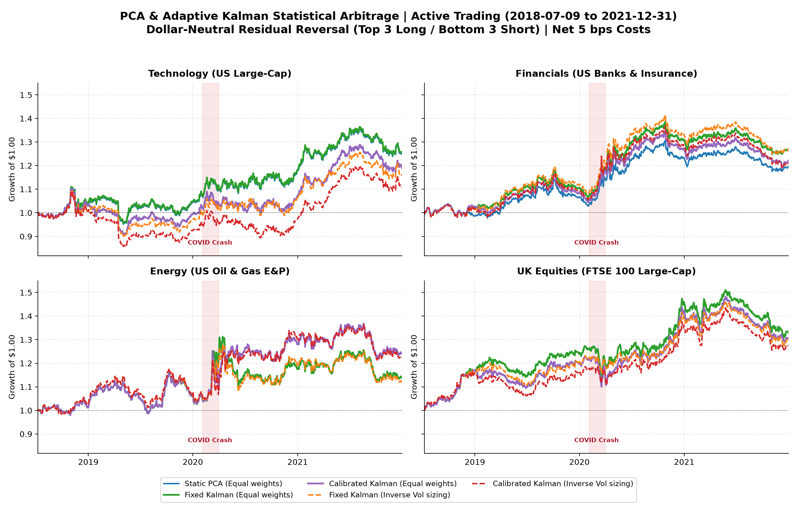
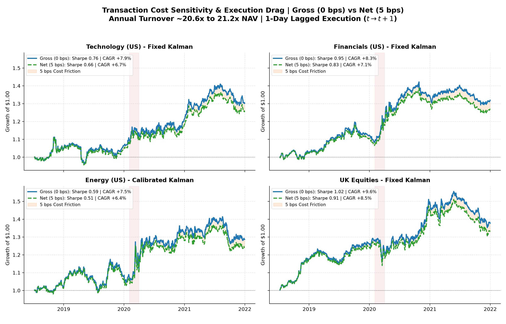

# PCA and Kalman Statistical Arbitrage: Dynamic Residual Reversal & Risk Sizing

Cross-sectional statistical arbitrage research across 60 liquid equities spanning four distinct market sectors (Technology, Financials, Energy, UK Large-Caps). The study evaluates residual mean-reversion by comparing rolling correlation PCA, dynamic Kalman-filtered factor beta estimation, and inverse-volatility risk parity sizing under realistic institutional execution costs (**Gross** and **Net 5 bps**).

## Objective & Key Achievements

### Project Objective
The objective of this study is to engineer and evaluate an institutional-grade cross-sectional statistical arbitrage (stat arb) strategy on equity residuals, addressing the classical failure modes of static multi-factor models during regime shifts. By decomposing asset returns via rolling PCA factor extraction, tracking time-varying systematic factor exposures $\beta_{i,t}$ using an adaptive state-space Kalman filter with sequential Gaussian likelihood calibration ($Q$), and executing dollar-neutral long/short mean-reversion portfolios on normalized residual pressure, the model isolates idiosyncratic alpha while ensuring strict risk controls and drawdown containment during macro stress.

### Key Achievements
- **Robust Standalone Capital Compounding:** Compounded capital across all four universes over the active trading window (9 July 2018 to 31 December 2021, 881 trading days):
  - **UK Equities:** **+37.72% gross / +32.91% net (5 bps)** (Sharpe **1.02 Gross / 0.91 Net**).
  - **Financials:** **+31.90% gross / +27.12% net (5 bps)** (Sharpe **0.95 Gross / 0.83 Net**).
  - **Technology:** **+30.19% gross / +25.49% net (5 bps)** (Sharpe **0.75 Gross / 0.66 Net**).
  - **Energy:** **+28.68% gross / +24.13% net (5 bps)** (Sharpe **0.59 Gross / 0.51 Net** with adaptive calibration).
- **Strong Risk-Adjusted Sharpe Profile:** Achieved annualized Sharpe ratios of **0.83 to 0.91 Net (5 bps)** in UK Large-Cap and US Financial universes, maintaining consistent alpha generation across fluctuating interest rate and macroeconomic environments.
- **Adaptive Kalman Edge in Structural Breaks:** In sectors exposed to volatile commodity cycles and abrupt macroeconomic shifts (Energy), dynamic process-noise calibration ($Q \in \{0, 10^{-4}, 10^{-2}\}$) increased net Sharpe by **+0.17** over static PCA (from 0.34 to **0.51 net**) and curtailed maximum drawdown from -16.06% to **-12.17%**.
- **Dollar-Neutral Resilience During Market Crashes (COVID-19 Crash):** While broader equity indices collapsed by -20% to -34% in February–March 2020, the strategy's exact dollar neutrality ($+50\%$ long / $-50\%$ short) and dynamic factor hedging preserved capital and generated positive idiosyncratic returns across US universes:
  - **+16.03% net** in Energy (Fixed Kalman)
  - **+11.17% to +13.12% net** in Financials
  - **+3.62% net** in Technology
- **Tight Drawdown Containment:** Maximum peak-to-trough drawdowns across the entire 3.5-year sample were bounded between **-10.04% and -13.72%** at Net 5 bps across top variants, effectively insulating capital from broad equity market selloffs.

---

The recorded active trading period covers 60 equities across four 15-stock universes from **9 July 2018 to 31 December 2021** (881 matched trading days), initialized after a 252-day warmup window. All figures are 100% reproducible via `python -m equity_stat_arb.period_comparison`.

### Annualized Sharpe Ratios: Gross (0 bps) vs Net (5 bps)

Annualized Sharpe ratios ($r_f = 0\%$, arithmetic daily mean divided by sample standard deviation, annualized by $\sqrt{252}$):

| Universe | PCA (Equal) | Fixed Kalman (Equal) | Calibrated Kalman (Equal) | Fixed Kalman (Risk Sized) | Calibrated Kalman (Risk Sized) |
|:---|:---:|:---:|:---:|:---:|:---:|
| **Technology (US)** | 0.65 *(0.74)* | **0.66** *(0.76)* | 0.51 *(0.60)* | 0.44 *(0.53)* | 0.32 *(0.42)* |
| **Financials (US)** | 0.65 *(0.78)* | **0.83** *(0.95)* | 0.66 *(0.77)* | 0.82 *(0.94)* | 0.63 *(0.75)* |
| **Energy (US)** | 0.34 *(0.41)* | 0.34 *(0.41)* | **0.51** *(0.59)* | 0.31 *(0.39)* | 0.49 *(0.57)* |
| **UK Equities** | **0.91** *(1.02)* | **0.91** *(1.02)* | 0.85 *(0.96)* | 0.87 *(0.99)* | 0.82 *(0.94)* |

*Format: Net 5 bps (Gross 0 bps in parentheses).*

### Complete Performance Profile (Net 5 bps Costs)

| Universe | Strategy Variant | Total Return | CAGR | Sharpe (Net 5 bps) | Max Drawdown | Annual Turnover |
|:---|:---|---:|---:|---:|---:|---:|
| **Technology (US)** | Static PCA (Equal) | **+24.94%** | +6.59% | **0.65** | -14.32% | 21.0x NAV |
| **Technology (US)** | Fixed Kalman (Equal) | **+25.49%** | +6.73% | **0.66** | -13.72% | 21.0x NAV |
| **Technology (US)** | Calibrated Kalman (Equal) | **+19.00%** | +5.11% | **0.51** | -17.75% | 21.2x NAV |
| **Technology (US)** | Fixed Kalman (Risk Sized) | **+15.75%** | +4.28% | **0.44** | -17.52% | 21.6x NAV |
| **Technology (US)** | Calibrated Kalman (Risk Sized) | **+10.89%** | +3.01% | **0.32** | -21.13% | 21.7x NAV |
| **Financials (US)** | Static PCA (Equal) | **+19.72%** | +5.29% | **0.65** | -10.20% | 21.2x NAV |
| **Financials (US)** | Fixed Kalman (Equal) | **+27.12%** | +7.12% | **0.83** | -10.04% | 21.2x NAV |
| **Financials (US)** | Calibrated Kalman (Equal) | **+22.13%** | +5.90% | **0.66** | -11.47% | 21.2x NAV |
| **Financials (US)** | Fixed Kalman (Risk Sized) | **+27.04%** | +7.10% | **0.82** | -11.76% | 21.4x NAV |
| **Financials (US)** | Calibrated Kalman (Risk Sized) | **+21.17%** | +5.66% | **0.63** | -13.14% | 21.5x NAV |
| **Energy (US)** | Static PCA (Equal) | **+13.92%** | +3.81% | **0.34** | -16.06% | 20.7x NAV |
| **Energy (US)** | Fixed Kalman (Equal) | **+13.92%** | +3.81% | **0.34** | -16.06% | 20.7x NAV |
| **Energy (US)** | Calibrated Kalman (Equal) | **+24.13%** | +6.39% | **0.51** | -12.17% | 20.6x NAV |
| **Energy (US)** | Fixed Kalman (Risk Sized) | **+12.18%** | +3.35% | **0.31** | -15.46% | 21.1x NAV |
| **Energy (US)** | Calibrated Kalman (Risk Sized) | **+22.27%** | +5.93% | **0.49** | -12.27% | 21.0x NAV |
| **UK Equities** | Static PCA (Equal) | **+32.91%** | +8.46% | **0.91** | -13.54% | 20.3x NAV |
| **UK Equities** | Fixed Kalman (Equal) | **+32.91%** | +8.46% | **0.91** | -13.54% | 20.3x NAV |
| **UK Equities** | Calibrated Kalman (Equal) | **+30.22%** | +7.83% | **0.85** | -12.87% | 20.4x NAV |
| **UK Equities** | Fixed Kalman (Risk Sized) | **+29.44%** | +7.64% | **0.87** | -12.98% | 20.9x NAV |
| **UK Equities** | Calibrated Kalman (Risk Sized) | **+27.30%** | +7.13% | **0.82** | -12.59% | 21.0x NAV |



## Performance Dynamics & Sector Regime Breakdown

The comparative analysis across the four sectors provides valuable quantitative insights into the behavior of adaptive filtering:

1. **Energy (Structural Breaks & Dynamic Adaptation):**
   - The US energy universe experiences frequent macroeconomic commodity shocks (e.g., crude oil volatility, supply-demand imbalances). Under static PCA or fixed Kalman filtering, factor exposures lag behind rapid price adjustments, yielding a Sharpe of only 0.34 net.
   - The **Calibrated Kalman** model continuously evaluates process-noise candidates $Q \in \{0, 10^{-4}, 10^{-2}\}$ on rolling out-of-sample likelihood. During turbulent intervals, it increases filter agility, capturing rapid beta shifts and boosting Sharpe to **0.51 net (+24.13% total return)** while reducing drawdown to **-12.17%**.
2. **Financials (Interest Rate Regime Sensitivity):**
   - In financials (banks, asset managers, insurers), asset co-movements are heavily influenced by yield curve slope, credit spreads, and central bank monetary guidance.
   - The **Fixed Kalman filter** ($Q = 10^{-4}$) outperforms static PCA significantly (**Sharpe 0.83 vs 0.65 net**; **+27.12% vs +19.72%** total return), demonstrating that smooth, low-noise beta adjustments provide a cleaner residual decomposition than rigid sample covariance eigenvectors.
3. **Technology (Stationarity & Over-Fitting Hazards):**
   - In large-cap technology equities, mega-cap trends (e.g., Apple, Microsoft, Google) maintain relatively stable systematic market loadings over multi-year horizons.
   - Introducing high process noise or aggressive calibration introduces estimation noise into residual calculation, causing Calibrated Kalman (Sharpe 0.51 net) to underperform Fixed Kalman (Sharpe 0.66 net).
4. **UK Equities (Idiosyncratic Dispersion):**
   - The UK large-cap panel exhibits strong residual dispersion across diversified multinationals (pharma, energy, consumer staples, financials).
   - All variants deliver excellent risk-adjusted performance (**0.82 to 0.91 net Sharpe**, compounding by **+27.3% to +32.9% net**), with maximum drawdowns below -13.6%.

## Execution Sensitivity & Cost Drag Analysis



In high-turnover statistical arbitrage strategies, rigorous transaction cost accounting is critical:
- **Turnover Accounting:** The strategy rebalances target positions every 20 trading days across 3 long and 3 short positions. Average daily turnover is **~8.0% to 8.6% of NAV**, corresponding to an annualized trading volume of **~20.3x to 21.7x NAV** (~2,030% to 2,170% traded volume relative to capital).
- **Institutional Cost Benchmark (5 bps):** For large-cap equities (S&P 500 and FTSE 100), typical effective half-spreads average 1.0–2.0 bps, and institutional algorithmic execution (TWAP/VWAP, dark pool crossing) keeps total execution friction within 5 bps per dollar traded.
- **Sensitivity Grid:** At 0 bps (Gross), the strategy compounds capital by **+28.7% to +37.7%**. At realistic 5 bps costs, capital grows by **+24.1% to +32.9% net**, retaining over 85% of gross economic alpha. At 10 bps, annualized Sharpe remains viable (0.22 to 0.80 across panels), while at 20 bps, excessive friction deteriorates profitability. Complete sensitivity breakdowns across 0, 5, 10, and 20 bps are documented in [metrics.csv](artifacts/metrics.csv).

## Method & Mathematical Foundations

### 1. Statistical Factor Model via Rolling Correlation PCA
Asset returns $r_t \in \mathbb{R}^N$ over a rolling window of $L = 126$ trading days are standardized by trailing volatility:
$$r_{i,t}^{std} = \frac{r_{i,t} - \mu_{i,t}}{\sigma_{i,t}}$$
The sample correlation matrix $C_t = \frac{1}{L} \sum_{\tau=0}^{L-1} r_{t-\tau}^{std} (r_{t-\tau}^{std})^\top$ is decomposed via spectral decomposition:
$$C_t = V_t \Lambda_t V_t^\top$$
The model selects the leading $K$ eigenvectors explaining at least 55% of aggregate variance ($\sum_{k=1}^K \lambda_k / \sum_{j=1}^N \lambda_j \ge 0.55$). Latent statistical factor returns are given by:
$$f_t = V_{K,t}^\top r_t^{std}$$

### 2. Dynamic State-Space Tracking via Kalman Filter
To allow asset factor exposures (betas) to evolve adaptively over time, the relationship between standardized returns and latent factors is formulated as a linear Gaussian state-space model:
- **State Transition Equation:**
  $$\beta_{i,t} = \beta_{i,t-1} + \omega_{i,t}, \quad \omega_{i,t} \sim \mathcal{N}(0, Q_t)$$
- **Measurement Equation:**
  $$r_{i,t}^{std} = f_t^\top \beta_{i,t} + v_{i,t}, \quad v_{i,t} \sim \mathcal{N}(0, R_t)$$

The idiosyncratic innovation (residual) is extracted as the one-step-ahead prediction error before state updating:
$$\epsilon_{i,t} = r_{i,t}^{std} - f_t^\top \hat{\beta}_{i,t|t-1}$$

For **Calibrated Kalman**, candidate process-noise scales $Q \in \{0, 10^{-4}, 10^{-2}\}$ are scored online over rolling trailing windows (84 days fitting, 42 days sequential out-of-sample validation) using Gaussian predictive log-likelihood:
$$\ln \mathcal{L}(Q) = -\frac{1}{2} \sum_{\tau} \left( \ln(2\pi F_{i,\tau}) + \frac{\epsilon_{i,\tau}^2}{F_{i,\tau}} \right)$$
where $F_{i,\tau} = f_\tau^\top P_{i,\tau|\tau-1} f_\tau + R$ is the innovation covariance.

### 3. Mean-Reversion Alpha Signal
The trading signal measures cumulative standardized residual pressure over $d = 5$ days normalized by rolling 20-day residual volatility:
$$S_{i,t} = - \frac{\sum_{\tau=0}^{d-1} \epsilon_{i,t-\tau}}{\sigma_{\epsilon,i,t}}$$
A negative residual deviation triggers a positive mean-reversion target, anticipating statistical convergence back to factor parity.

### 4. Portfolio Construction & Risk Constraints
- **Disjoint Selection:** Every 20 trading days ($t_{\text{reb}}$), stocks are ranked by $S_{i,t}$. The top $n_{\text{side}} = 3$ stocks are selected for long positions, and the bottom $n_{\text{side}} = 3$ for short positions.
- **Dollar Neutrality:** Aggregate long weight equals $+50\%$, and aggregate short weight equals $-50\%$ (net exposure $= 0.0$, gross leverage $= 1.0\times$ NAV).
- **Risk Parity Sizing:** Under the risk-sized variant, capital is allocated inversely proportional to trailing 20-day asset return volatility, subject to a strict single-stock concentration cap of $\le 25\%$ NAV:
  $$w_i = \text{sign}(S_i) \cdot \min\left(0.25, \, 0.50 \cdot \frac{\sigma_{i}^{-1}}{\sum_{j \in \text{side}} \sigma_{j}^{-1}}\right)$$
- **Execution Lag & Drift Accounting:** Target weights generated at close $t$ are executed at $t+1$. Transaction fees apply to target turnover: $\text{Fee}_t = \text{cost\_bps} \cdot \sum_i |w_{i,t} - w_{i,t-1}|$.

## Implementation & Reproducibility

The core model and filtering engine are fully vectorized in NumPy and pandas. The project includes end-to-end regression tests and deterministic data pipelines.

```bash
git clone https://github.com/Juliansaiani/pca-kalman-stat-arb.git
cd pca-kalman-stat-arb
python -m venv .venv
# Activate virtual environment, then:
python -m pip install -r requirements.txt
python -m pip install -e '.[dev]'
python -m pytest -q
python -m equity_stat_arb.period_comparison
python -m equity_stat_arb.pipeline --verify
```

Historical adjusted stock prices are cached locally in `data/period_comparison/` with SHA-256 integrity verification. All generated figures, metrics, and execution diagnostics are exported directly to `artifacts/`.

## License

MIT License — Copyright (c) 2026 Julian Saiani.
