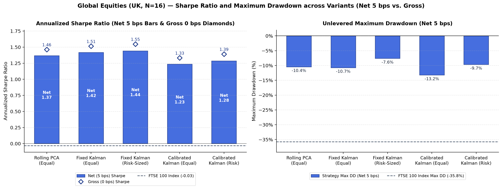
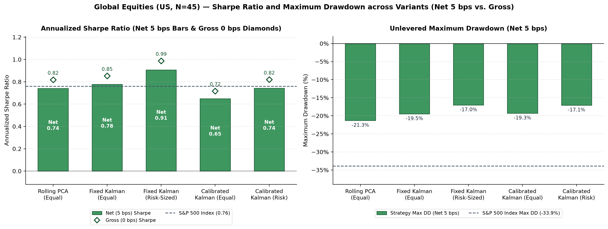
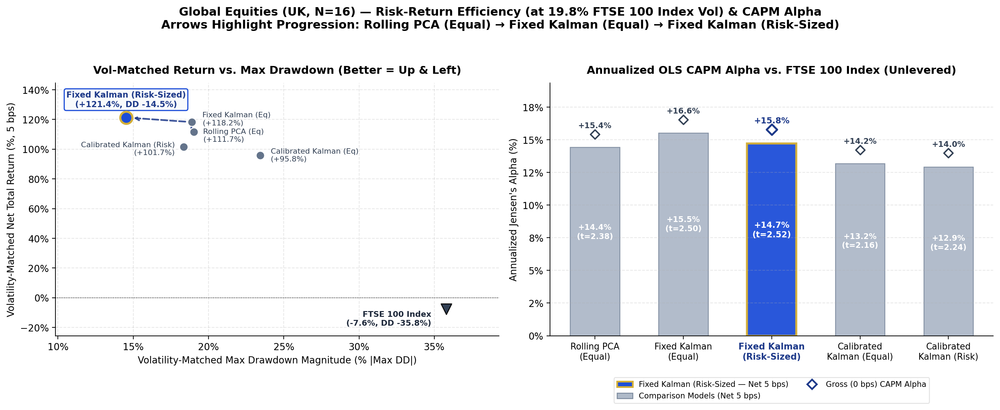
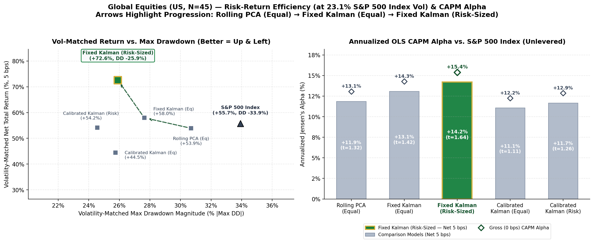

# PCA vs. Kalman Statistical Arbitrage: Dynamic Betas & Risk Sizing

**Research question:** Does tracking time-varying factor betas with a Kalman Filter and sizing positions by inverse 20-day return volatility improve dollar-neutral residual mean reversion relative to static Rolling PCA?

This repository compares five systematic residual-reversal variants across UK equities (`16` FTSE 100 names) and US equities (`45` S&P 500 names spanning Technology, Financials, and Energy) over the matched trading window from **9 July 2018 to 30 June 2021** (`754` UK sessions, `751` US sessions), preceded by `378` initialization sessions starting in January 2017.

## Headline Comparison: UK & US Equities

### Annualized Sharpe Ratio — Net 5 bps (Gross 0 bps in parentheses)

| Universe | Rolling PCA (Equal) | Fixed Kalman (Equal) | Fixed Kalman (Risk-Sized) | Calibrated Kalman (Equal) | Calibrated Kalman (Risk-Sized) |
|:---|:---:|:---:|:---:|:---:|:---:|
| **UK equities (`16` stocks)** | 1.37 (1.46) | 1.42 (1.51) | **1.44 (1.55)** | 1.23 (1.33) | 1.28 (1.39) |
| **US equities (`45` stocks)** | 0.74 (0.82) | 0.78 (0.85) | **0.91 (0.99)** | 0.65 (0.72) | 0.74 (0.82) |

- **Fixed Kalman vs. PCA:** Replacing static Rolling PCA (`1.37` UK / `0.74` US net Sharpe) with a Fixed Kalman filter (`1.42` / `0.78`) and inverse-volatility position sizing (`1.44` / `0.91`) improves risk-adjusted return and cuts max drawdown (**-10.4% -> -7.6%** in UK; **-21.3% -> -17.0%** in US).
- **Likelihood-Calibrated Kalman:** Online likelihood calibration of $Q$ underperformed `Fixed Kalman` across both broad universes (`1.28` vs. `1.44` UK; `0.74` vs. `0.91` US). It only improved results on narrower sector subsets such as Energy (`0.77` vs. `0.57`, logged in [metrics.csv](artifacts/metrics.csv)).
- **Validation Limitations:** `Calibrated Kalman` selects $Q$ sequentially without lookahead (`84` fit + `42` likelihood-scoring days), but model variants and stock universes were evaluated over the `2017–2021` panel without an untouched post-study holdout. Performance weakens materially during persistent mega-cap momentum regimes such as `H2 2021`.





## Unlevered & Volatility-Matched Benchmark Context

On an unlevered `1.0x` gross basis (`+50%` long / `-50%` short, `10.2%–14.9%` annualized volatility):
- UK equities (`Fixed Kalman Risk-Sized`): **+52.8% Net** (+57.7% Gross) cumulative return, `10.2%` vol, **-7.6% Max DD**, with annualized CAPM alpha of +14.7% Net ($t = 2.52$) / +15.8% Gross ($t = 2.70$) and $\beta = +0.062$ vs. `^FTSE`.
- US equities (`Fixed Kalman Risk-Sized`): **+44.8% Net** (+50.1% Gross) cumulative return, **-17.0% Max DD**, with +14.2% Net / +15.4% Gross annualized alpha and $\beta = -0.039$ vs. `^GSPC`.

To compare cumulative compounding on an equal volatility scale against 100% long national indices, daily strategy returns are scaled ex post by the full-sample ratio of index volatility to strategy volatility (`1.81x–1.94x` in UK at `19.8%` FTSE vol; `1.45x–1.55x` in US at `23.1%` S&P 500 vol). This is an ex-post risk normalization, not a dynamically levered live backtest.

| Market & Benchmark | Variant | Ex-Post Scale | Vol-Matched Net (5 bps) | Vol-Matched Gross (0 bps) | Net CAGR | Net Sharpe (Gross) | Vol-Matched Max DD | Unlevered $\alpha$ / $\beta$ |
|:---|:---|---:|---:|---:|---:|---:|---:|---:|
| **UK vs. FTSE 100** | Rolling PCA (Equal) | 1.88x | +111.7% | +124.1% | +28.5% | 1.37 (1.46) | -19.0% | +14.4% / +15.4% (+0.057) |
| **UK vs. FTSE 100** | Fixed Kalman (Equal) | 1.81x | +118.2% | +131.0% | +29.8% | 1.42 (1.51) | -18.9% | +15.5% / +16.6% (+0.093) |
| **UK vs. FTSE 100** | **Fixed Kalman (Risk-Sized)** | **1.94x** | **+121.4%** | **+135.4%** | **+30.4%** | **1.44 (1.55)** | **-14.5%** | **+14.7% / +15.8%** (+0.062) |
| *FTSE 100 (`^FTSE`)* | *Price Index (100% Long)* | *1.00x* | *-7.6%* | — | *-2.6%* | *-0.03* | *-35.8%* | *Benchmark ($\beta = 1.000$)* |
| **US vs. S&P 500** | Rolling PCA (Equal) | 1.49x | +53.9% | +62.3% | +15.6% | 0.74 (0.82) | -30.7% | +11.9% / +13.1% (-0.021) |
| **US vs. S&P 500** | Fixed Kalman (Equal) | 1.45x | +58.0% | +66.4% | +16.6% | 0.78 (0.85) | -27.6% | +13.1% / +14.3% (-0.042) |
| **US vs. S&P 500** | **Fixed Kalman (Risk-Sized)** | **1.55x** | **+72.6%** | **+82.4%** | **+20.1%** | **0.91 (0.99)** | **-25.9%** | **+14.2% / +15.4%** (-0.039) |
| *S&P 500 (`^GSPC`)* | *Price Index (100% Long)* | *1.00x* | *+55.7%* | — | *+16.0%* | *0.76* | *-33.9%* | *Benchmark ($\beta = 1.000$)* |





## Model Design & Portfolio Rules

1. **Factor Extraction (`L = 126` days, refit every 10 sessions):** Standardized asset returns $r_{i,t}^{\mathrm{std}} = (r_{i,t} - \mu_{i,t}) / \sigma_{i,t}$ yield sample correlation matrix $C_t = V_t \Lambda_t V_t^\top$. Retaining the leading $K$ eigenvectors capturing $\ge 55\%$ variance defines latent factors $f_t = V_{K,t}^\top r_t^{\mathrm{std}}$.
2. **Time-Varying Beta Filtering:**
   $$\beta_{i,t} = \beta_{i,t-1} + \omega_{i,t}, \quad \omega_{i,t} \sim \mathcal{N}(0, Q_t); \qquad r_{i,t}^{\mathrm{std}} = f_t^\top \beta_{i,t} + v_{i,t}, \quad v_{i,t} \sim \mathcal{N}(0, R_t)$$
   Innovations $\epsilon_{i,t} = r_{i,t}^{\mathrm{std}} - f_t^\top \hat{\beta}_{i,t|t-1}$ are recorded prior to the state update (`q_fixed = 1e-4` for US universes, `uk_q_fixed = 5e-4` for UK). For `Calibrated Kalman`, $Q \in \{0, 10^{-4}, 10^{-2}\}$ is scored via Gaussian predictive log-likelihood over the trailing 42 sessions inside the 126-day window.
3. **Signal & Construction (`20`-day rebalance):** Stocks are ranked on $S_{i,t} = -\sum_{\tau=0}^{4} \epsilon_{i,t-\tau} / \sigma_{\epsilon,i,t}$ (5-day residual pressure over 20-day residual vol). The top/bottom $n_{\mathrm{side}} = 3$ names receive $+50\% / -50\%$ allocation, either equal-weighted or proportional to $\sigma_i^{-1}$ (trailing 20-day asset return volatility) capped at `25%` NAV per stock with iterative budget redistribution.
4. **Turnover & Cost Model:** Weights lag signal close $t$ by one day (`t -> t+1`). Daily turnover averages `8.0%–9.5%` NAV (`~20.1x–24.1x` annualized), retaining `89%–92%` of gross return at `5 bps`. Rebalance fees are charged at each 20-day cycle on target weight changes without intermediate drift-maintenance trades, short-borrow fees, or financing costs.

## Data Conventions & Methodological Limits

- **Dividend Treatment Discrepancy vs. Benchmarks:** Individual stock series use dividend-adjusted closes (`auto_adjust=True`), while `^FTSE` and `^GSPC` are **price-return indices** (excluding dividends). Long-only total-return benchmarks (`^SP500TR`, FTSE Total Return) compound higher than price indices; market-neutral daily CAPM alphas and Sharpe rankings are unaffected in sign.
- **Survivor-Selected Large-Cap Panels:** The `16` UK and `45` US constituents are liquid names selected retrospectively (`data/period_comparison/`), introducing survivorship bias and limiting direct extrapolation without historical index-constituent point-in-time lists.
- **Standalone Sector Runs:** Separate `15`-stock sector results (`technology`, `financial`, `energy`) and `0/5/10/20` bps sweeps remain in [metrics.csv](artifacts/metrics.csv) and [benchmarks.csv](artifacts/benchmarks.csv).

## Running & Tests

```bash
git clone https://github.com/Juliansaiani/pca-kalman-stat-arb.git
cd pca-kalman-stat-arb
python -m pip install -r requirements.txt
python -m pip install -e '.[dev]'
python -m pytest -q
python -m equity_stat_arb.pipeline --verify
python -m equity_stat_arb.period_comparison
```

See [notebooks/research.ipynb](notebooks/research.ipynb) for interactive inspection of tables and diagnostics.

## License

MIT License — Empirical study conducted in 2023; repository cleaned and published in 2026. Copyright (c) 2023 Julian Saiani.
