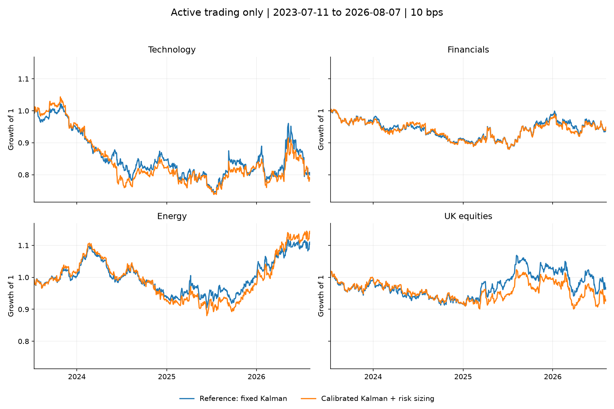

# PCA and Kalman statistical arbitrage

A residual-reversal study comparing rolling PCA, Kalman-filtered exposures and inverse-volatility sizing across four 15-stock universes. Each experiment uses the same calendar bounds for every universe and starts only after all portfolios are active.


## Results

Historical annualized Sharpe at 10 bps per unit of target-weight turnover. The reference uses fixed Kalman exposures and equal weights; the combined variant adds noise calibration and inverse-volatility sizing.

| Universe | 2018–2021 reference | 2018–2021 combined | 2023–2026 reference | 2023–2026 combined |
|---|---:|---:|---:|---:|
| Technology | 0.558 | 0.223 | -0.408 | -0.486 |
| Financials | 0.710 | 0.520 | -0.230 | -0.208 |
| Energy | 0.262 | 0.416 | 0.382 | 0.474 |
| UK equities | 0.798 | 0.702 | -0.092 | -0.229 |

The 2017–2021 input sample is more favorable overall. Its common active trading window is **9 July 2018 to 31 December 2021**. The 2022–2026 input sample trades from **11 July 2023 to 7 August 2026**. Warmup returns are excluded from both the figures and these metrics. Every panel in a figure shares the same date bounds and vertical scale.

Calibration and risk sizing do not consistently improve the reference: they help energy, but weaken the earlier technology, financial and UK results. Both periods were inspected; selecting the better period afterwards is historical selection, not independent validation.



PCA uses 126 past trading days, refits every 10 days and retains 55% explained variance. Calibration compares three process-noise scales on past predictive likelihood: 84 fitting days followed by 42 sequential validation days. The filter resets when the PCA basis changes.

The signal ranks five-day residual pressure scaled by 20-day residual volatility. Three stocks per side are selected every 20 days, after 252 residual observations of warmup. Risk sizing uses preceding 20-day stock volatility, 50% per side and a 25% target position cap. Positions are lagged one day before earning returns.

Accounting uses a constant daily target-weight approximation. Costs cover changes in those targets; holding drift and maintenance trades are omitted. Borrow fees, financing, short availability and market impact are excluded. Universes are hand-picked, and dollar neutrality does not imply factor neutrality.

## Run

The recorded results used Python 3.14.7 on Windows.

```bash
python -m venv .venv
# Windows: .venv\Scripts\activate
# macOS/Linux: source .venv/bin/activate
python -m pip install -r requirements.txt
python -m pip install -e '.[dev]'
python -m equity_stat_arb.period_comparison
python -m pytest -q
```

The first run downloads adjusted prices directly from Yahoo Finance through `yfinance`. Later runs check and reuse the local snapshot. Fresh downloads may differ if the provider revises its history. Source settings, hashes, versions and actual evaluation bounds are in `artifacts/period_comparison/run.json`. Changing dates does not trigger a parameter search: model and allocation rules are identical across both samples.

Start with [the executed notebook](notebooks/research.ipynb). All five variants and 0–20 bps costs are in `artifacts/period_comparison/metrics.csv`. Code is in `src/equity_stat_arb/`, settings in [config.json](config.json), and raw prices remain outside Git. Code is released under [MIT](LICENSE); market data has separate usage terms.

The earlier mixed-period calculation remains a separate numerical regression check: `python -m equity_stat_arb.pipeline --verify`. Its frozen input sources and assumptions are recorded in `artifacts/run.json`; those archived figures are not the matched-period results above.
